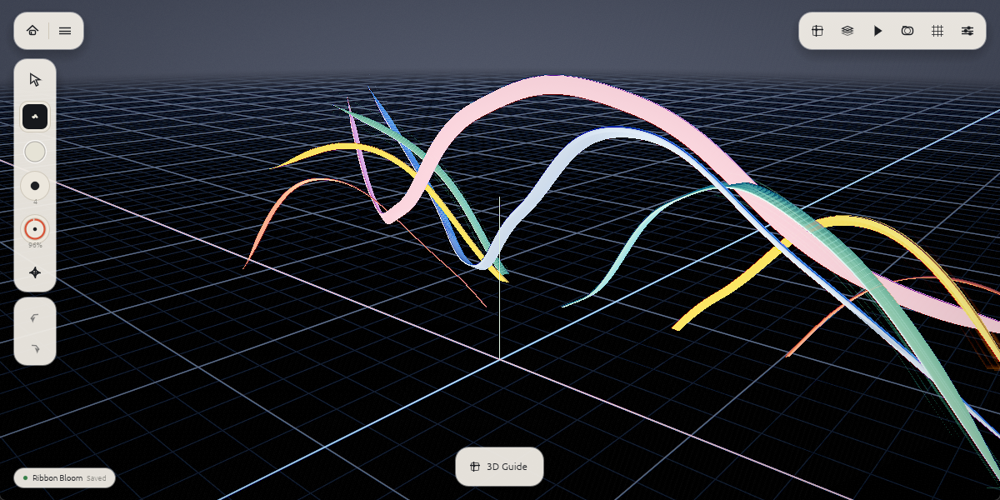
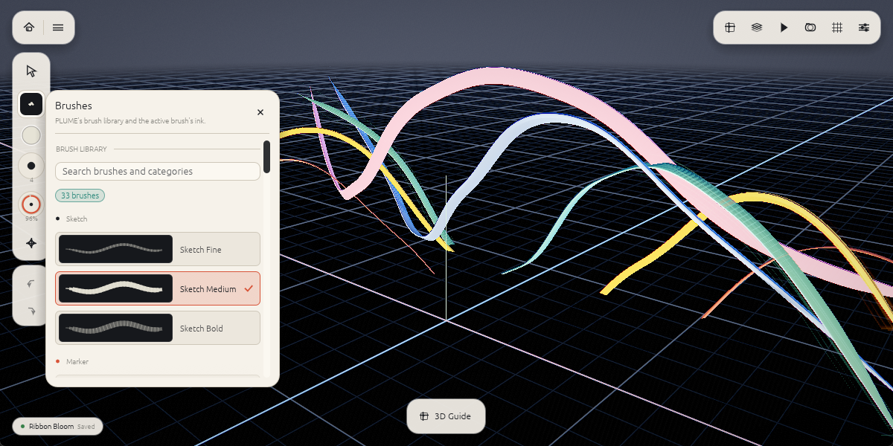
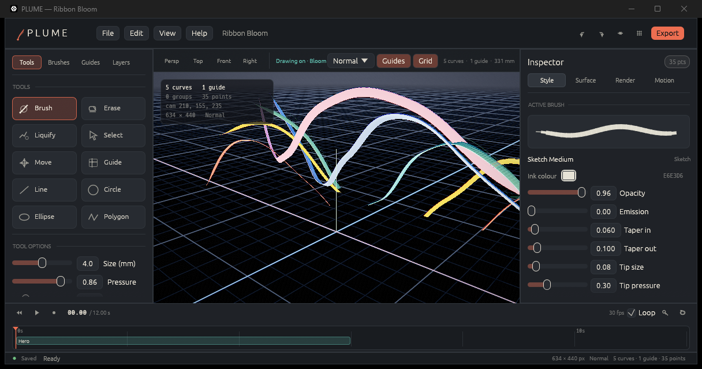
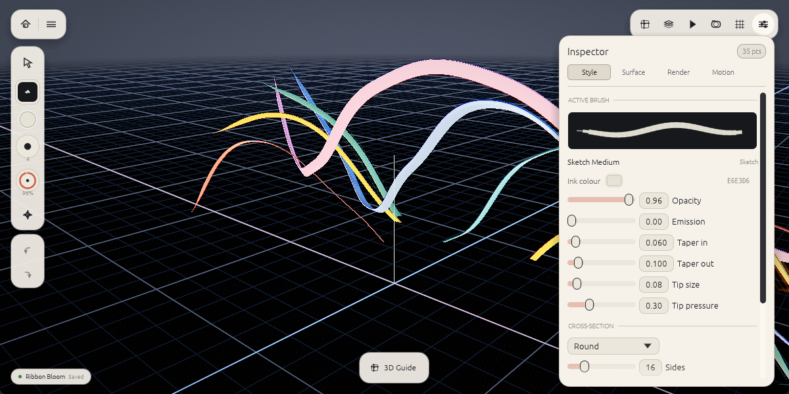
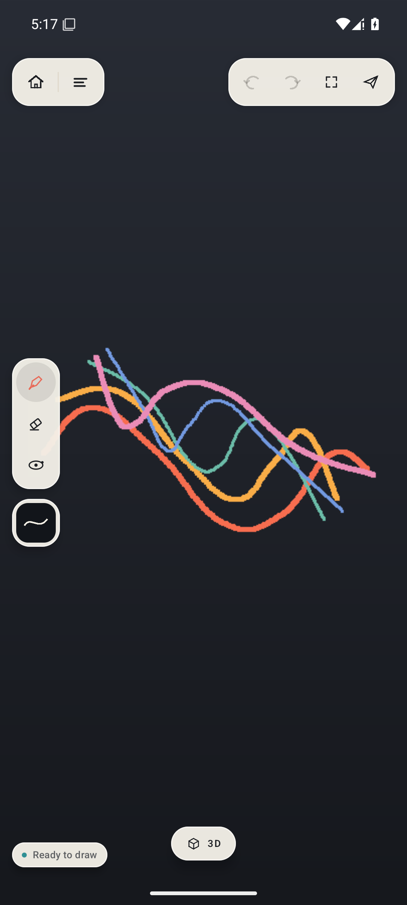

# PLUME

**PLUME is a 3D curve studio.** Draw pressure-aware strokes in space, wrap them
in procedural materials, build on construction surfaces, light the result like a
product shot, and export a model, still or turntable.

The repository contains two shells over one Rust engine:

- **PLUME Studio** — a Rust/wgpu desktop editor with a canvas-first floating
  shell, a full Studio workspace, an offscreen HDR renderer, 33 brushes, guides,
  liquify, groups, animation and model/media export.
- **PLUME for Android** — a Kotlin/Jetpack Compose touch editor and ARCore
  placement view backed by the same `plume-core` document model through UniFFI.

PLUME is an original, clean-room implementation. It does not contain Feather
artwork, icons, fonts, binaries or presets. See [NOTICE.md](NOTICE.md).

## Screenshots

| Canvas-first shell | Brush library |
| --- | --- |
|  |  |

| Studio workspace | Inspector |
| --- | --- |
|  |  |



All eight built-in scenes are rendered by the headless renderer in
[`docs/renders/`](docs/renders/). They are generated from PLUME curves and
brushes, not from third-party artwork.

## Highlights

- **Canvas first, studio within reach.** The default shell floats paper chrome
  over the ink canvas: home and menu at the top left, quick tools at the top
  right, a brush rail on the left, a 3D stage guide at the bottom, and a
  contextual inspector. The original multi-panel Studio workspace remains one
  menu click away for power users.
- **Curves that behave like ribbons and tubes.** Catmull-Rom and circular
  strokes, rotation-minimising frames, pressure taper, round/flat/custom
  cross-sections and adaptive extrusion.
- **33 procedural brushes** across sketch, marker, calligraphy, ink, hatch,
  halftone, terrazzo, stipple, smooth, rough, taper and experimental families.
  Patterns are shader descriptions plus CPU sampling, not copied texture atlases.
- **Guides and picking.** Plane, box, sphere, cylinder, cone, torus, freeform,
  loft and imported-mesh guides; BVH-backed selection, surface snapping and
  marquee picking.
- **Direct editing.** Brush, erase, liquify (push/pull/twirl/pinch), select,
  move, line, circle, ellipse and polygon tools; duplicate, groups, mirror,
  visibility and locking.
- **A real render.** HDR colour, depth, shadow map, studio environment, up to
  three-point lighting, rim/specular response and a post stack with ACES tone
  mapping, bloom, vignette, grain, chromatic aberration, sharpen, fog, depth of
  field and outlines.
- **Animation.** Turntable playback, camera keyframes, camera shots, timeline
  scrubbing and GIF/MP4 capture.
- **Interchange.** Native `.plume` packages, best-effort `.feather` interchange,
  OBJ/MTL, glTF/GLB, STL and USDZ export; OBJ/glTF/STL import; PNG/GIF/MP4 stills
  and animation. Mesh imports ask for the source unit (mm/cm/m/in) instead of
  guessing.
- **Desktop recovery.** Autosave writes a recovery package every 10 s while the
  document is dirty and offers Recover work or Discard on the next plain launch.
- **Mobile authoring.** The same canvas-first floating controls on touch:
  home/menu capsule, quick undo/frame/export tools, brush rail, 3D stage menu,
  touch drawing with pressure, orbit/pinch/pan, gallery, brush browser,
  undo/redo, animation scrubbing, autosave, SAF export and ARCore tabletop
  placement without Sceneform.

## Quick start

Prebuilt Windows binaries and the Android APK are published on the
[releases page](https://github.com/aamirenic/Plume/releases). The project site
is at [aamirenic.github.io/Plume](https://aamirenic.github.io/Plume/).

Requirements:

- Rust stable with `rustfmt` and `clippy` (pinned by `rust-toolchain.toml`)
- A Vulkan, DX12, Metal or GLES 3 adapter; a software adapter is also supported
- For Android: JDK 17, Android SDK 35, NDK 27.2 and the Rust Android targets

```bash
# Build and run the desktop studio
cargo run -p plume-app --release

# Run the full Rust test suite
cargo test --workspace

# Lint the workspace
cargo clippy --workspace --all-targets -- -D warnings

# Regenerate committed samples, previews and import fixtures
cargo run -p plume-core --example generate_samples
```

### Headless capture

```bash
# Render a gallery scene
cargo run -p plume-app -- --gallery ribbon-bloom \
  --render ribbon.png --width 2400 --height 1500 --quality export

# Render an existing document
cargo run -p plume-app -- --file samples/documents/neon-knot.plume \
  --render neon.png --quality high

# Open the studio on a specific scene or document
cargo run -p plume-app --release -- --gallery wire-flora
cargo run -p plume-app --release -- samples/documents/terrazzo-tile.plume

# Import a metre-authored mesh at the correct scale
cargo run -p plume-app --release -- --import-units m testdata/import-cube.obj
```

Relative paths are resolved inside the PLUME sandbox, not the shell's current
directory. The default sandbox is the parent of the Cargo workspace; point it at
the repository when you want repo-local output paths:

```bash
PLUME_SANDBOX="$PWD" cargo run -p plume-app -- \
  --gallery ribbon-bloom --render docs/renders/ribbon-bloom.png
```

On PowerShell:

```powershell
$env:PLUME_SANDBOX = (Get-Location).Path
cargo run -p plume-app -- --gallery ribbon-bloom --render docs/renders/ribbon-bloom.png
```

On hosts whose hardware graphics driver crashes during wgpu device creation,
select the software adapter explicitly:

```bash
PLUME_SOFTWARE=1 cargo run -p plume-app --release
```

## Controls

| Input | Action |
| --- | --- |
| Right-drag / Alt+left-drag | Orbit |
| Shift+right-drag / middle-drag | Pan |
| Wheel | Zoom |
| B / E / L | Brush, erase, liquify |
| V / T / G | Select, move, guide |
| C | Straight line |
| 1 / 2 / 3 / 4 | Perspective, top, front, right |
| F / Home | Frame selection / frame scene |
| Shift+Home | Frame visible artwork only (excludes guides) |
| `[` / `]` | Brush size down / up |
| Space | Play or pause animation |
| Ctrl+Z / Ctrl+Y | Undo / redo |
| Ctrl+S / Ctrl+Shift+S | Save / save as |
| Ctrl+O / Ctrl+N | Open / new |
| Ctrl+D / Ctrl+G / Ctrl+Shift+G | Duplicate / group / ungroup |
| Delete | Delete selection |

The in-app **Help → Quick start and shortcuts** dialog mirrors this list.

## Files and safety

- `.plume` is a ZIP package with `document.json`, an optional `thumbnail.png`,
  `manifest.json` and optional `assets/`. Saves are atomic: PLUME writes and
  flushes a sibling temporary file, then renames it over the destination.
- `.feather` is a documented PLUME interchange archive, not a claim of native
  Feather compatibility. Import recovers JSON point arrays and OBJ entries on a
  best-effort basis and reports what it skipped.
- Every read and write is constrained to a sandbox. Archive readers reject path
  traversal, absolute paths, oversized entries and archives that expand beyond
  512 MiB.
- The desktop app installs nothing and changes no PATH, registry key or service.
  The Android app requests no network permission and performs no analytics.
- MP4 output uses a local `ffmpeg` executable (or `PLUME_FFMPEG`); FFmpeg is not
  redistributed.

See [docs/FORMATS.md](docs/FORMATS.md) for the document and interchange details.

## Repository map

```text
core/       UI-agnostic Rust engine: curves, RMF, guides, BVH, extrusion,
            brushes/patterns, liquify, animation, render data, import/export
app/        Desktop studio (eframe + wgpu) and headless renderer
ffi/        UniFFI bridge consumed by the Android shell
android/    Kotlin/Compose app, ARCore activity and Gradle project
samples/    Generated .plume documents, previews and interchange files
testdata/   Generated OBJ/glTF/STL import fixtures
docs/       Format reference and curated QA renders
```

## Verification

The current verified state is:

- `cargo test --workspace`: **224 tests pass** (191 core, 25 desktop, 8 FFI)
- `cargo clippy --workspace --all-targets -- -D warnings`: clean
- `cargo fmt --all -- --check`: clean
- Android `testDebugUnitTest`, `lintDebug` and `assembleDebug`: **BUILD
  SUCCESSFUL**, 0 lint errors
- APK: `arm64-v8a` and `x86_64` native bridges packaged
- All eight gallery scenes rendered headlessly and visually inspected

GitHub Actions runs the formatting, test, clippy and desktop-release checks on
every push and pull request.

Android has been compile, lint and package verified and smoke-tested on an
Android 15 emulator: touch drawing, framing, the gallery, export sheet and AR
entry all run. It has not been exercised on a physical device. The desktop build
has been run on a Windows DX12 adapter and the software wgpu fallback; hardware
coverage beyond that depends on the host driver.

## Android

PLUME for Android shares the desktop's canvas-first shell: paper chrome floats
over the ink canvas, with a home/menu capsule, quick undo/frame/export tools, a
brush rail, a 3D stage menu, and an optional timeline.

```bash
# Native bridge (once per ABI)
rustup target add aarch64-linux-android x86_64-linux-android
export ANDROID_NDK_HOME="$ANDROID_SDK_ROOT/ndk/27.2.12479018"
cargo ndk -t arm64-v8a -t x86_64 \
  -o android/app/src/main/jniLibs build --release -p plume-ffi

# Build
cd android
./gradlew :app:testDebugUnitTest :app:lintDebug :app:assembleDebug
```

Full Android instructions, including UniFFI regeneration and ARCore notes, are
in [android/README.md](android/README.md).

## Documentation

- [docs/FORMATS.md](docs/FORMATS.md) — document and interchange formats
- [samples/README.md](samples/README.md) — sample provenance and regeneration
- [testdata/README.md](testdata/README.md) — import fixture provenance
- [THIRD_PARTY.md](THIRD_PARTY.md) — third-party software and licenses

## License

PLUME source is released under the MIT license. Third-party dependencies retain
their own licenses. Feather is a name owned by its respective owner and is used
only to describe an optional interchange format.
